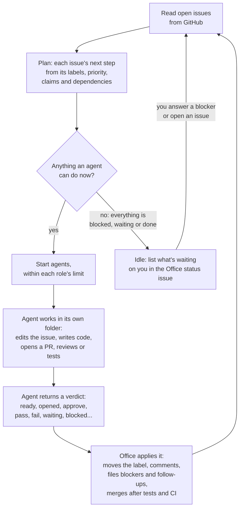
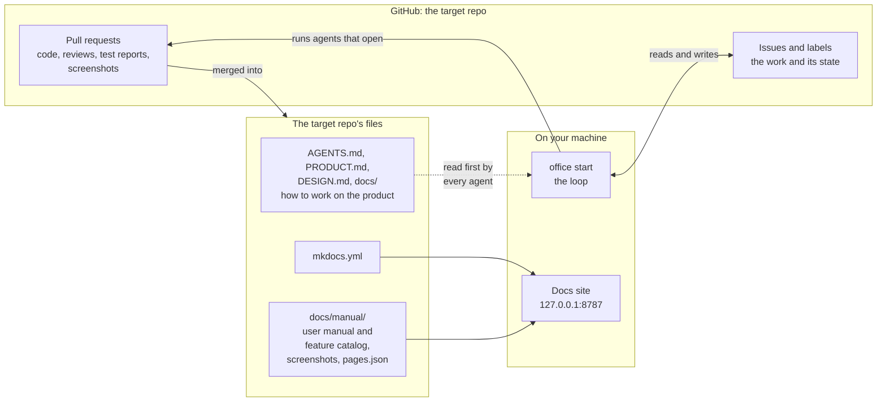

# How it works

The office in three pictures: the agent loop that drives everything, the path one feature takes from your request to your review and release, and where each piece of information lives. Details are in [Workflow](WORKFLOW.md), [Testing](TESTING.md) and [Docs site and user manual](DOCS-SITE.md).

## 1. The agent loop

`office start` runs one loop on your machine. Every minute it reads the target repo's open issues from GitHub, decides what each one needs next from its labels, and hands the work to an agent. Agents do the work and report back with a short verdict. Only the office changes labels, files blockers and merges.

What keeps it running unattended:

- **GitHub is the only state.** Stop the office at any time: Ctrl-C or `office stop` lets running agents finish first, and `office start` picks up from the labels.
- **Agents never guess.** A decision only you can make becomes a blocker issue you can answer in under a minute, and the office carries on with other work.
- **Sequencing isn't your problem.** An issue that needs another to land first waits, and is requeued when that issue closes.
- **Failures are contained.** A step that fails three times becomes a blocker, a role that hits its usage limit pauses while the others continue, and anything an agent leaves running is stopped.

## 2. One feature, from request to release

You describe an outcome in a GitHub issue. Everything after that, including the documentation you review it through, is produced by the office.

```mermaid
flowchart LR
    U([You open an issue]) --> PM[PM: triage<br/>acceptance criteria,<br/>priority, split]
    PM --> DS[Designer: impeccable shape<br/>flows, states, copy,<br/>manual entry, screens to capture]
    DS --> EN[Engineer: build<br/>code, tests,<br/>user manual, pages.json]
    EN --> RV[Codex: review<br/>a second model<br/>checks the diff]
    RV --> TS[Codex: test<br/>verify, acceptance criteria,<br/>Playwright screenshots,<br/>UX checks, mkdocs build]
    TS --> MG[Office: merge<br/>after CI]
    MG --> SITE[MkDocs site refreshes<br/>with the new manual<br/>and screenshots]
    SITE --> R([You review the<br/>manual and screens])
    MG --> REL[Office: Release issue<br/>lists what isn't live yet]
    REL --> AP([You add<br/>release:approved])
    AP --> DEP[Office: verify,<br/>then the repo's<br/>release command]
    DEP --> LIVE[Codex: check<br/>the live site]
    LIVE -. fail: you approve<br/>a rollback .-> DEP
    RV -. changes .-> EN
    TS -. fail .-> EN
```

The documentation is part of the work, not an afterthought:

| Step | Its part of the documentation |
|---|---|
| **Triage** | The acceptance criteria require "the user manual and its screenshots are updated" for anything users see. |
| **Design** | The design comment includes the manual entry, written for end users, and the screens to capture. |
| **Build** | The PR updates `docs/manual/README.md`, adds the pages to `docs/manual/pages.json`, and passes `mkdocs build --strict`. |
| **Test** | [Playwright](https://playwright.dev/) captures every manual page at desktop and phone widths, checks for broken pages and layout problems, and commits the screenshots. A missing or wrong manual entry fails the PR. |
| **Merge** | The changed screens are posted on the PR and the "Office status" issue, and the live site at `http://127.0.0.1:8787` updates. |
| **Release** | After you approve a release, Codex checks the live site with the same pages from `docs/manual/pages.json`. |
| **Practices review** | Daily, the PM flags features with no manual section, stale screenshots, and docs that no longer match the code. |

## 3. Where things live

Two contexts are kept apart. The office's instructions (roles, labels, prompts) live in this repo. Everything about the product, including its manual, lives in the target repo, which stays understandable to a human team that has never heard of the office. See [Architecture](ARCHITECTURE.md#two-contexts-kept-separate).

---
[← Back to the README](../README.md)
